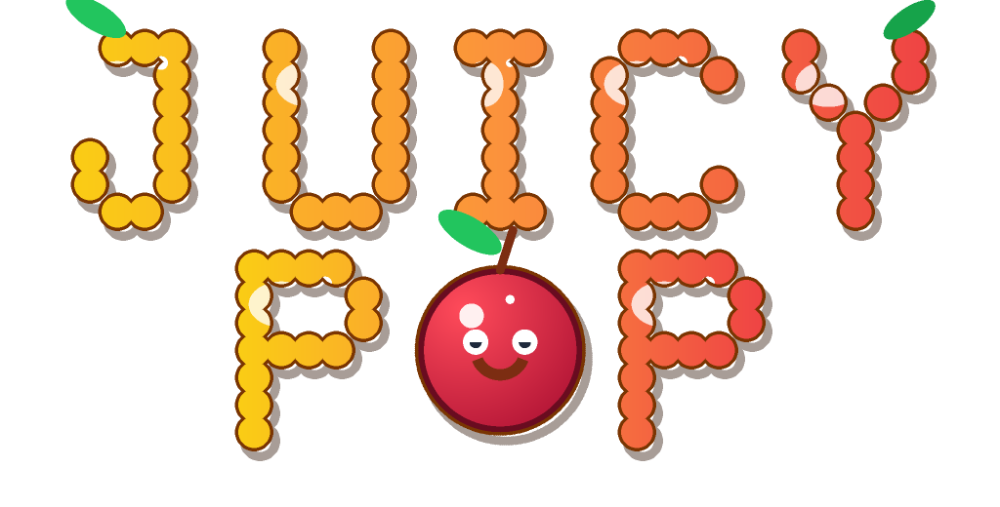

# Juicy Pop: Fruit Merge Mania 🍉



An addictive, endless "drop, slide & merge" physics puzzle with 10 evolving tiers
of cute animated fruits, power-ups (Shake, Bomb, Swap), combo scoring and juicy
synthesized ASMR audio — 100% offline, zero external assets.

## Play

- **Web (PWA)**: https://ravi9689370-oss.github.io/juicy-pop/
  - Open on phone → "Add to Home Screen" → plays fully offline.
- **Android**: debug APK built automatically on every push to `main`
  → Actions tab → run "Build Android APK" → download artifact `juicy-pop-game-apk`.

## Features

- Custom vanilla Canvas + 2D physics engine (gravity 0.45, restitution 0.3, friction 0.1,
  fixed-step @60fps logic), circular stacking with mass-weighted separation.
- 10 fruit tiers (Cherry 18px → Watermelon 108px) — exact PRD sizes, colors, points, mass.
- 0.6s drop cooldown, dotted aim laser, red danger ceiling (3s dwell = Game Over).
- Combo chain: merges within 0.7s multiply the reward (neon text + sparkle chime).
- Power-ups: 🌪️ SHAKE (10🪙), 💣 BOMB (30🪙), 🔄 SWAP (15🪙); +250 coins per game.
- Score / best / coins persisted in localStorage.
- All sound synthesized live via Web Audio API (0 bytes of audio files).
- All art drawn procedurally on Canvas (icons generated by `scripts/gen-icons.js`).
- PWA: `manifest.json` + `sw.js` cache-first shell for zero-network play.

## Structure

```
.github/workflows/
  pages.yml          → deploys the site to GitHub Pages
  android-build.yml  → Capacitor + Gradle → app-debug.apk artifact
index.html, css/, js/ (game, physics, fruits, particles, audio)
manifest.json, sw.js, package.json, capacitor.config.json
```

## Dev

```
npm install          # only needed for Capacitor CI builds
node scripts/gen-icons.js   # regenerate icons
npx serve .          # quick local test
```
